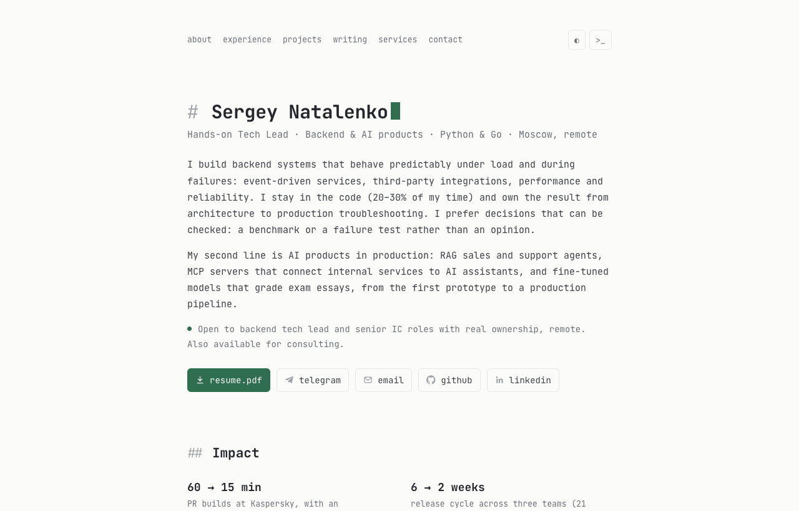

<div align="center">

# `#` Sergey Natalenko

**Hands-on Tech Lead · Backend & AI products · Python & Go**

[andy-takker.github.io](https://andy-takker.github.io) · [resume.pdf](https://andy-takker.github.io/resume.pdf) · [Telegram](https://t.me/natalenko_sergey) · [LinkedIn](https://www.linkedin.com/in/sergey-natalenko) · [Habr](https://habr.com/ru/users/andy-takker/)

[](https://andy-takker.github.io)
[](https://pages.github.com/)
[](#make-your-own-in-5-minutes)
[](LICENSE)

<picture>
  <source media="(prefers-color-scheme: dark)" srcset=".github/screenshot-dark.png">
  
</picture>

</div>

A personal site that works as a resume, a portfolio and a business card at once.
It reads like a markdown file, it looks like a terminal, and it ships zero JavaScript frameworks.

## What's inside

- **Markdown-editor look.** Headings keep their `#` / `##` markers, everything is set in JetBrains Mono.
- **A real shell.** Press <kbd>`</kbd> on the page: `help`, `ls`, `cd projects`, `open github`, `theme light`, Tab completion, history. Try `sudo hire-me`.
- **Light and dark** themes that follow the OS, with a toggle.
- **Content in YAML.** An article is three lines, a new job is one block. Edit on github.com, and Pages rebuilds in about a minute.
- **Prints as a resume.** <kbd>⌘P</kbd> gives a clean one-column CV with every job expanded.
- **SEO done:** canonical URL, Open Graph and Twitter cards, JSON-LD `ProfilePage` + `Person`, sitemap, robots.txt.
- **Small.** One HTML template, one stylesheet, ~120 lines of vanilla JS. Works without JS.

## Make your own in 5 minutes

1. Click **Use this template** (or fork) and name the repo `<your-username>.github.io`.
2. Edit the content:

   | What | Where |
   |------|-------|
   | Jobs | `_data/jobs.yml` |
   | Projects and experiments | `_data/projects.yml` (`group`: `projects`, `ai` or `experiments`) |
   | Articles | `_data/articles.yml` |
   | Name, intro, impact numbers, services, stack, contacts, SEO tags | `index.html` |
   | Links for the shell | `LINKS` in `main.js` |
   | Social preview | `og.png` (1200×630) |
   | Resume | `resume.pdf` |

3. In **Settings → Pages**, set the source to the `main` branch. Done.

Adding an article looks like this:

```yaml
# _data/articles.yml, newest first
- title: Why your mocks don't catch real bugs
  url: https://habr.com/ru/articles/1034864/
  date: May 2026
```

Put a value in quotes if it contains a colon.

## Local preview

```sh
docker run --rm -p 4000:4000 -v "$PWD":/srv/jekyll jekyll/jekyll:3.8 jekyll serve
```

Then open http://localhost:4000.

## License

The code (HTML, CSS, JS) is [MIT](LICENSE): take it and make it yours.
The content (texts, resume, photos) is © Sergey Natalenko. Please replace it with your own.

If this saved you an evening, a ⭐ helps others find it.
